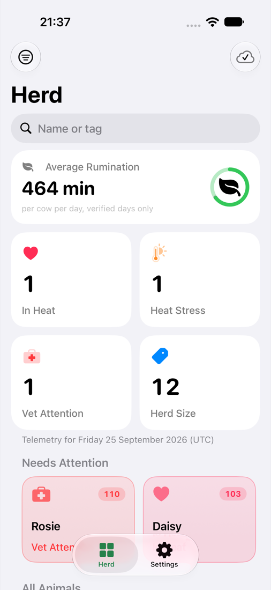
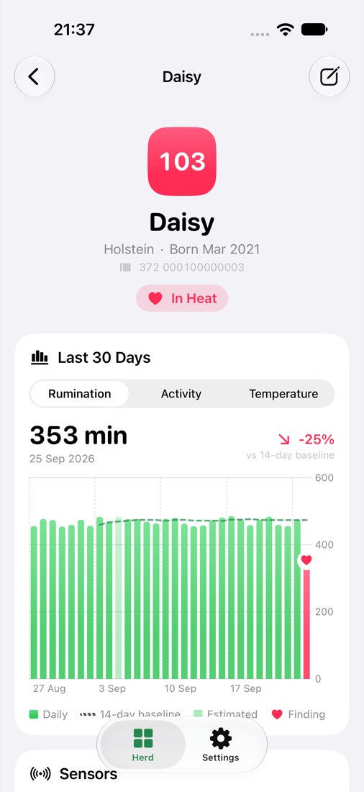
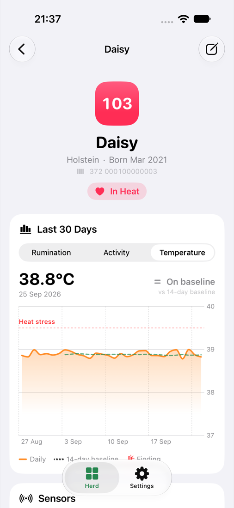
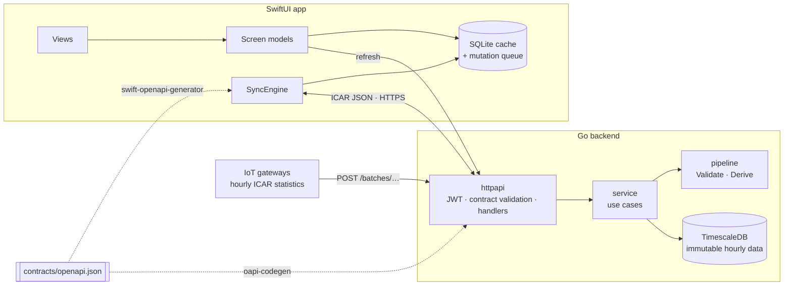
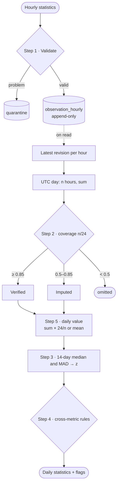
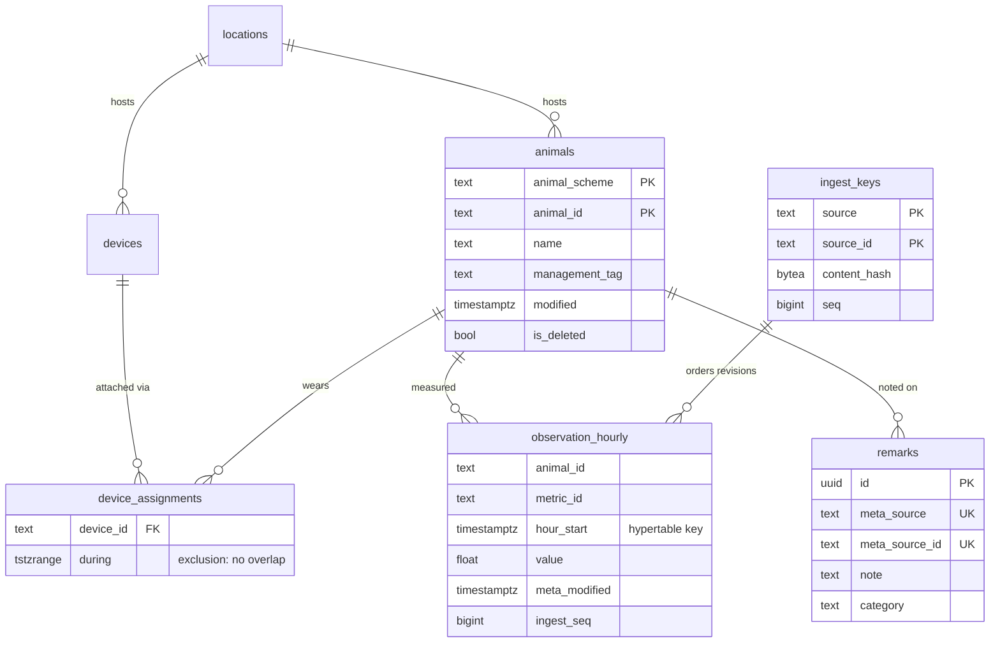
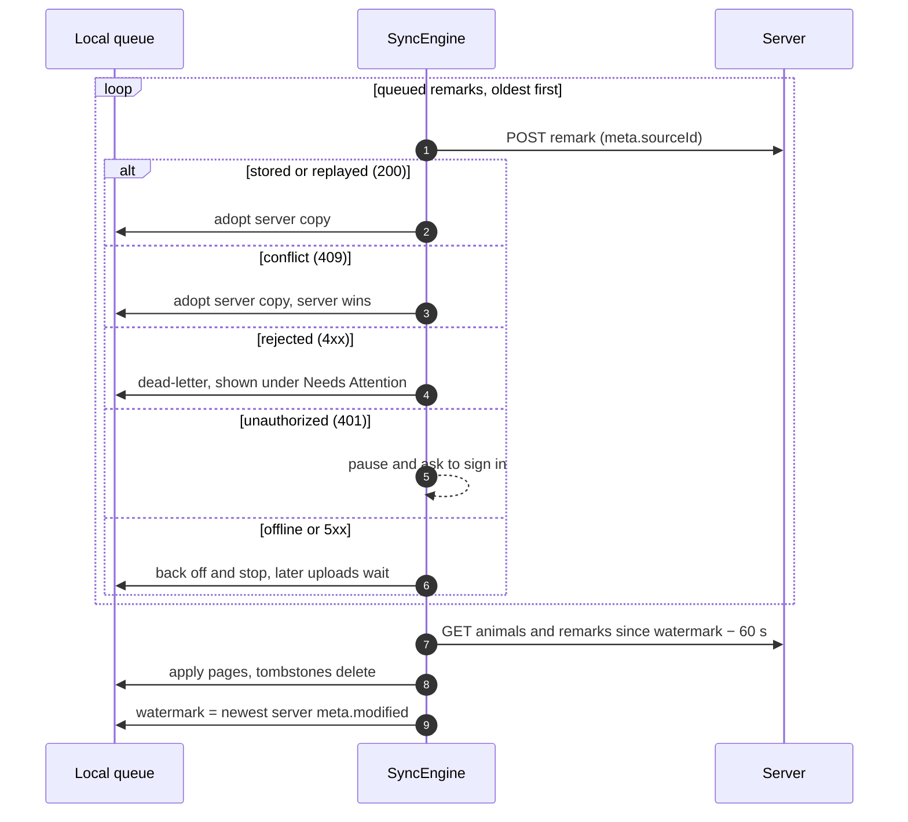
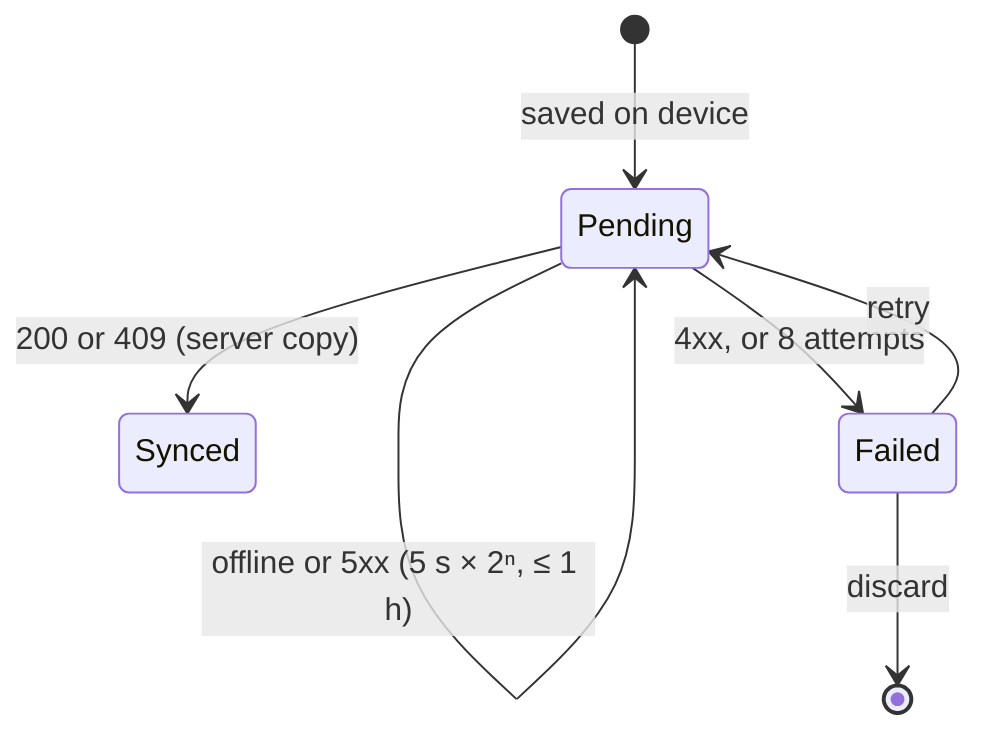

# Agritelem

**Precision livestock telemetry, end to end.** A Go ingestion and analytics backend on TimescaleDB, and an offline-first SwiftUI app for use on the farm. Both are generated from one OpenAPI contract built on the [ICAR Animal Data Exchange](https://github.com/adewg/ICAR) 1.5.1 standard.

Sensors on each cow (rumen boluses, pedometers, collars) report through a farm gateway every hour. Agritelem:
- validates that telemetry and stores it immutably
- derives daily values against each animal's own 14-day baseline
- flags estrus (heat), heat stress and data-quality problems

Farmers see the herd on their phone, drill into any animal's last 30 days, and record observations in the field whether or not there is signal.

<p align="center">
  
  
  
</p>

---

## Contents

- [Highlights](#highlights)
- [Architecture](#architecture)
- [Domain primer](#domain-primer)
- [API](#api)
- [Cleaning pipeline](#cleaning-pipeline)
- [Data model](#data-model)
- [Offline sync](#offline-sync)
- [Security](#security)
- [iOS app](#ios-app)
- [Getting started](#getting-started)
- [Configuration](#configuration)
- [Testing](#testing)
- [Performance](#performance)
- [Repository layout](#repository-layout)
- [Design decisions](#design-decisions)
- [Limitations and roadmap](#limitations-and-roadmap)

---

## Highlights

**Backend (Go 1.27)**
- **Built on ICAR ADE 1.5.1.** It uses ICAR's location-scoped paths, `{scheme, id}` identifiers, `org.icar.activities` metric codes and batch results. Agritelem data travels in *additive* extensions that a build step checks can never alter ICAR itself.
- **Contract-first.** `contracts/openapi.json` generates the Go server (oapi-codegen) and the Swift client (swift-openapi-generator). Every request is validated against it before reaching a handler.
- **Correct under retries and late data.**
  - A retried upload is a no-op; a changed payload under the same ID is reported as a conflict.
  - Observations are append-only revisions.
  - Daily statistics are derived when read, so a late hour can never leave a stale baseline.
- **Robust statistics.** Coverage-aware imputation, median/MAD baselines, and cross-metric findings, all as pure functions.
- **Proven with a real database.** Integration tests run against TimescaleDB in Docker (testcontainers-go), including concurrent writers and forced rollbacks.

**iOS (Swift 6, iOS 26)**
- **Offline-first.** A GRDB-backed cache and FIFO mutation queue. A sync engine actor guarantees ordered uploads, backs off failed ones and parks rejects under *Needs Attention*, and takes its pull watermark from the server rather than the device clock.
- **Idiomatic SwiftUI.**
  - `@Observable` screen models, one view type per section.
  - Swift Charts with drag-to-inspect and UTC-correct axes.
  - SF Symbols with symbol effects, Liquid Glass navigation, previews for every screen.
- **Hermetic UI tests.** A built-in demo mode drives XCUITest flows without a server.

---

## Architecture



| Layer | Package | Responsibility |
|---|---|---|
| Contract | `backend/internal/contract`, `cmd/contractgen` | Builds `contracts/openapi.json` from the vendored ICAR bundle plus `contracts/agritelem.yaml`: selects operations, deep-merges additively, prunes to the reference closure, normalises constructs generators mishandle. |
| Domain | `backend/internal/domain` | ISO 11784 identifiers, the metric catalogue and bounds, remark validation, content hashes. Standard library only. |
| Pipeline | `backend/internal/pipeline` | `Validate` (step 1) and `Derive` (steps 2–5). Pure and deterministic, with the clock injected. |
| Persistence | `backend/internal/store` | pgx + sqlc; goose migrations are embedded. A hypertable for hourly observations, a ledger for idempotency, and quarantine. |
| Use cases | `backend/internal/service` | Ingest orchestration, summaries, herd overview, remarks. Depends on a narrow `Store` interface. |
| HTTP | `backend/internal/httpapi`, `internal/auth` | Generated strict server, handlers, middleware, ICAR error bodies, EdDSA JWT. |
| iOS core | `ios-client/Packages/AgritelemKit` | `Domain`, `APIClient` (generated client behind a protocol), `Persistence` (GRDB), `Sync` (actor). |
| iOS app | `ios-client/App`, `Views`, `ViewModels` | Composition root, screen models, SwiftUI views. |

A deeper walkthrough is in [docs/architecture.md](docs/architecture.md), and the full system specification in [spec.md](spec.md).

---

## Domain primer

**ICAR ADE.** The International Committee for Animal Recording publishes *Animal Data Exchange*: JSON resources and REST paths for moving livestock data between farm systems. Agritelem uses 1.5.1 (OpenAPI 3.1, JSON Schema 2020-12), vendored in [`contracts/vendor/icar-ade-1.5.1`](contracts/vendor/icar-ade-1.5.1) and pinned by commit.

**Animal identity.** An animal is identified by a scheme and an ID. Agritelem accepts the two ICAR schemes built on ISO 11784/11785:

| Scheme | Format | Example |
|---|---|---|
| `std.iso.11785` | 15 ASCII digits: a 3-digit ISO 3166-1 numeric country code, a manufacturer code (900–998) or the test code 999, then 12 digits | `372000100000003` (Ireland) |
| `eu.animalId` | as above, country codes only | `276000312312345` (Germany) |

The parser is table-tested and fuzzed (5.4 M executions in 20 s without a counterexample [measured: `go test -fuzz FuzzParseAnimalID -fuzztime 20s`]).

**Metrics.** Gateways report five metrics per hour:

| Metric | ICAR code | Unit | Meaning |
|---|---|---|---|
| Rumination | `org.icar.activities / RuminationTime` | minutes | Time chewing the cud. It falls with illness, stress and estrus. |
| Eating | `org.icar.activities / EatingTime` | minutes | Time at the feed face. |
| Lying | `org.icar.activities / LyingTime` | minutes | Rest. Lameness and heat stress change it. |
| Activity | `org.icar.activities / StepCount` | steps | Pedometer count. It spikes during estrus. |
| Reticular temperature | `agritelem.metrics / ReticularTemperature` | °C | Core temperature from a rumen bolus; sustained highs mean heat stress or fever. |

**Why hourly ingest.** Completeness is the first cleaning step: a daily value built from 12 hours of data is not the same as one built from 24. Only hourly granularity lets the server measure coverage and grade each day as Verified, Imputed or omitted. Summarising at the edge still cuts bandwidth by more than 99.99 % compared with raw 20 Hz three-axis accelerometer streams (216,000 samples per animal-hour become 5 statistics).

---

## API

Base path: ICAR's location scheme, `/locations/{location-scheme}/{location-id}/…`. The contract is in [`contracts/openapi.json`](contracts/openapi.json).

| Method | Path | Scope | Purpose |
|---|---|---|---|
| `POST` | `/batches/locations/{s}/{id}/observation-summary-metrics` | `observations:write` | Ingest up to 5,000 hourly summary resources |
| `GET` | `/locations/{s}/{id}/observation-summary-metrics` | `animals:read` | Daily (`P1D`) or hourly (`PT1H`) statistics for one animal |
| `GET` | `/locations/{s}/{id}/animals` | `animals:read` | Animals, with `meta-modified-from`, keyset paging and tombstones |
| `GET` | `/locations/{s}/{id}/devices` | `animals:read` | Sensors and their current assignment |
| `GET` | `/locations/{s}/{id}/remarks` | `remarks:read` | Remarks, filterable by animal |
| `POST` | `/locations/{s}/{id}/remarks` | `remarks:write` | Record a remark (idempotent on `meta.sourceId`) |
| `GET` | `/agritelem/locations/{s}/{id}/herd-overview` | `animals:read` | Herd KPIs and per-animal status (Agritelem extension) |

### Ingesting telemetry

```sh
curl -X POST http://localhost:8080/batches/locations/dk.herdnumber/123456/observation-summary-metrics \
  -H "Authorization: Bearer $TOKEN" -H "Content-Type: application/json" -d '[{
    "resourceType": "icarObservationSummaryResource",
    "animal": { "scheme": "std.iso.11785", "id": "372000100000003" },
    "meta":   { "source": "ie.example.gateway", "sourceId": "gw-7:2026-09-25T03", "modified": "2026-09-25T04:00:00Z" },
    "statistics": [{
      "metric": { "scheme": "org.icar.activities", "id": "RuminationTime" },
      "startDateTime": "2026-09-25T03:00:00Z", "duration": "PT1H",
      "aggregation": "Sum", "unit": "MIN", "value": 27.5
    }]
  }]'
```

The response carries one `icarBatchResult` per resource, in request order. An accepted resource has an `id` and no messages. Everything else explains itself:

```json
[
  { "id": "01a0deeb-…", "meta": { "source": "ie.example.gateway", "sourceId": "gw-7:2026-09-25T03", "…": "…" } },
  { "id": "01a0deeb-…", "messages": [{ "type": "REPLAYED", "severity": "Information", "title": "Already stored" }] },
  { "messages": [{ "type": "PHYSIOLOGICAL_OUTLIER", "severity": "Error", "status": 422,
                   "instance": "/statistics/0/value",
                   "detail": "RuminationTime value 61 MIN is outside the plausible hourly range [0, 60]" }] }
]
```

### Reading derived statistics

```sh
curl "http://localhost:8080/locations/dk.herdnumber/123456/observation-summary-metrics?animal-scheme=std.iso.11785&animal-id=372000100000003&duration=P1D&date-from=2026-09-20&date-to=2026-09-25" \
  -H "Authorization: Bearer $TOKEN"
```

Each daily statistic is a standard ICAR `icarObservationStatisticsType`, plus an `agritelem` extension carrying the pipeline's output. This is a real response for the simulated estrus day:

```json
{
  "metric": { "scheme": "org.icar.activities", "id": "RuminationTime" },
  "startDateTime": "2026-09-25T00:00:00Z", "duration": "P1D",
  "aggregation": "Sum", "unit": "MIN", "value": 347.29, "isIncomplete": false,
  "agritelem": { "coverage": 1, "dataQuality": "Verified",
                 "baselineMedian": 481.47, "zScore": -19.34, "flags": ["HeatSignature"] }
}
```

### Errors

Errors follow ICAR's `icarErrorCollection`: RFC 7807-style messages whose `type` is a stable code and whose `instance` is a JSON pointer to the offending field.

| Status | When |
|---|---|
| 400 | The request violates the contract (a concise message names the field), a page token is malformed, or a filter is unsupported |
| 401 / 403 | Missing or invalid token / missing scope or location grant |
| 404 | Unknown animal at this location |
| 409 | `POST remarks`: same `meta.sourceId`, different content. The body includes the stored `current` remark. |
| 413 | Body over 5 MiB or more than 5,000 resources |
| 422 | Semantically invalid content: every problem, with codes such as `SOURCE_MISMATCH`, `FUTURE_TIMESTAMP`, `INVALID_ANIMAL_ID` |

---

## Cleaning pipeline

Step 1 runs **at ingest** and decides what is stored. Steps 2–5 run **at read time** over the stored hours ([ADR 0003](docs/decisions/0003-validate-at-ingest-derive-at-read.md)). The maths and every threshold's provenance are in [docs/pipeline.md](docs/pipeline.md).



**Step 3, the robust baseline.** Over the previous 14 days (at least 7 required):

```
z = (value − median) / (1.4826 × MAD),   MAD = median(|xᵢ − median|)
```

1.4826 × MAD estimates the standard deviation, but a single outlier day barely moves it.

**Step 4, findings.**

| Flag | Rule |
|---|---|
| `HeatSignature` | rumination z ≤ −1.5 **and** steps z ≥ 2.0 on the same day |
| `ThermalStress` | daily mean reticular temperature ≥ 39.5 °C |
| `TimeBudgetConflict` | eating + lying > 1440 min |
| `DailyOutOfRange` | outside the metric's daily bounds (e.g. rumination > 720 min) |

---

## Data model



**Invariants the schema enforces, not just the code:**
- Hours are aligned (`CHECK`).
- A device can't be on two animals at once (a `btree_gist` exclusion constraint).
- `(source, sourceId)` is unique across all history. This lives in the `ingest_keys` ledger, because TimescaleDB refuses unique indexes that omit the partitioning column [measured: psql against 2.30.1-pg17] ([ADR 0004](docs/decisions/0004-idempotency-ledger.md)).
- Day boundaries are computed in UTC in SQL, independent of the session time zone. This is tested by querying through a UTC+14 session.

---

## Offline sync

The app works in a barn with no signal. Every remark is written locally, together with its queued upload, in one SQLite transaction. The `SyncEngine` actor then moves data when it can ([ADR 0005](docs/decisions/0005-offline-sync-protocol.md)).





**Guarantees.** Each has a test that fails when the rule is removed:
- Uploads reach the server in creation order.
- A retry after a lost response is idempotent.
- The device clock never decides what is pulled.
- The watermark advances only after every page has been applied.
- Concurrent sync triggers share one pass.
- Switching server forgets that server's watermarks and caches, but keeps unsent work.

---

## Security

- **Authentication.**
  - Ed25519-signed (EdDSA) JWTs are checked for `iss`, `aud` and `exp`, with 30 s leeway.
  - Tokens carry scopes and location grants, and every operation checks both.
  - Tests cover `alg: none`, HS256 key confusion, tampered payloads, foreign keys, expiry and wrong issuer or audience.
- **Provenance.** Writes must carry `meta.source` equal to the token subject, so a gateway cannot write as another.
- **Input handling.**
  - Tokens are verified before the body is read.
  - Bodies are capped at 5 MiB, and every request is validated against the OpenAPI contract.
  - Validation errors are summarised as field pointers rather than echoing schemas.
- **Data at rest.** Rejected resources are quarantined for diagnosis. Logs are structured (`log/slog`) and never include headers or bodies.
- **iOS.** The token is kept in the Keychain (after first unlock, this device only). App Transport Security permits plain HTTP to local-network addresses only, for the development server.

---

## iOS app

| Screen | What it does |
|---|---|
| **Herd** | KPI tiles (average rumination, in heat, heat stress, vet attention, herd size), a *Needs Attention* carousel, a searchable herd list with status symbols, a status filter, pull-to-refresh, and a sync indicator with a pending-upload badge |
| **Animal** | Header with tag badge, breed, age and ISO ID. A 30-day chart per metric: bars for daily totals (imputed days faded), a line with the heat-stress threshold for temperature, the dashed 14-day baseline, findings as SF Symbols, and drag-to-inspect callouts. Also sensors and the remark timeline with upload state. |
| **Remark** | A sheet for note, category and time. Saves offline; the upload happens automatically. |
| **Settings** | Account (token), sync status, *Needs Attention* (retry or discard rejected remarks), server |

**How it's built**
- `@MainActor @Observable` screen models hold `Equatable` state. Derived rows are cached as stored properties, so views never filter or sort inline.
- Every section is its own `View` with narrow inputs.
- Chart content is factored into `ChartContent` types, and axes render in UTC because the days are UTC days.
- The API client is generated from the same contract as the server and hidden behind an `AgritelemAPI` protocol. Its tests decode **responses captured from the running server**.
- **Demo mode.** Launching with `-AgritelemDemo` swaps in deterministic sample data and an in-memory store. Previews and UI tests use it, so neither needs a backend.

---

## Getting started

### Prerequisites

Go 1.27, Docker, Xcode 27 (iOS 26 SDK or later), [XcodeGen](https://github.com/yonaskolb/XcodeGen).

### Run everything

```sh
make up          # build and start TimescaleDB + the API on http://localhost:8080 (creates dev keys in .dev/)
make seed        # a 24-cow demonstration herd with sensors
make sim         # 21 days of hourly telemetry; prints throughput and latency
make token       # a 24-hour dev token for the demo gateway

make ios-project && open ios-client/Agritelem.xcodeproj
```

Run the **Agritelem** scheme on a simulator, open **Settings → Account** and paste the token. The simulated data includes:
- one cow in estrus on the last complete day
- one with an elevated temperature
- one whose sensor dropped out for ten hours

### Make targets

| Target | Purpose |
|---|---|
| `make up` / `make down` | Start the stack / stop it and delete its data |
| `make seed`, `make sim`, `make token` | Demo herd, simulated telemetry, dev token |
| `make contracts`, `make generate` | Rebuild the contract / all generated code (contract, Go server, SQL) |
| `make check-generated` | Fail if generated files differ from what is committed (CI) |
| `make lint` | golangci-lint v2, including integration-tagged code |
| `make test`, `make test-integration` | Go unit tests (race detector) / with TimescaleDB in Docker |
| `make ios-test-kit` | AgritelemKit tests on macOS |
| `make ios-build`, `make ios-test` | Build the app / run its unit and UI tests in the simulator |

### Troubleshooting

- **Xcode asks to trust "OpenAPIGenerator".** Accept it: the plugin generates the API client at build time. The `make` targets pass `-skipPackagePluginValidation`.
- **Port 5432 or 8080 is already in use.** Stop the other service, or change the port mappings in `compose.yaml`.
- **The simulator can't reach the API.** Check `make up` succeeded and that the Settings server is `http://localhost:8080`.

---

## Configuration

The API reads its configuration from the environment and reports every problem at once:

| Variable | Default | Meaning |
|---|---|---|
| `AGRITELEM_DATABASE_URL` | — (required) | PostgreSQL URL; the role must be able to create the `timescaledb` and `btree_gist` extensions when migrating |
| `AGRITELEM_JWT_PUBLIC_KEY_FILE` | — (required) | Ed25519 public key (PKIX PEM) |
| `AGRITELEM_JWT_ISSUER` / `AGRITELEM_JWT_AUDIENCE` | `agritelem-dev` / `agritelem-api` | Expected `iss` / `aud` |
| `AGRITELEM_LISTEN_ADDR` | `:8080` | Listen address |
| `AGRITELEM_PUBLIC_URL` | `http://localhost:8080` | Absolute base for pagination links |
| `AGRITELEM_MIGRATE_ON_START` | `false` | Apply embedded migrations at startup |
| `AGRITELEM_LOG_LEVEL` | `info` | `debug`, `info`, `warn`, `error` |

---

## Testing

A test only counts once it has been seen to fail. For the rules that matter (validation guards, idempotency, revision ordering, UTC bucketing, sync ordering and watermarks, auth checks) the process was:
1. Write the test.
2. Watch it fail for the predicted reason.
3. Fix the code and watch the test pass.
4. **Mutate the fix back out and watch the test fail again.**

Where a mutant survived, the cause was chased down: either the test was strengthened, or the code turned out to be redundant and was removed.

| Suite | How | Count |
|---|---|---|
| Go unit | table tests, a fuzz target, fakes behind interfaces | 60 top-level tests, 109 subtests (including integration) [measured: `go test -tags integration -json ./...`] |
| Go integration | testcontainers-go with `timescale/timescaledb:2.30.1-pg17`: idempotency under 8 concurrent writers, rollback on mid-batch failure, device overlap, keyset paging, a UTC+14 session, and tie-breaking with index scans disabled | part of the above |
| End-to-end HTTP | real store, service and handler: 15 days of telemetry → replay → conflict → quarantine → derived `HeatSignature` → herd overview; remark lifecycle; timestamp wire format | part of the above |
| Contract | the committed `openapi.json` equals the generator's output; kin-openapi validates it | part of the above |
| AgritelemKit | Swift Testing: API client against captured server responses, Persistence invariants, SyncEngine behaviour | 33 |
| App | Swift Testing view-model tests; XCUITest flow dashboard → detail → chart → remark, and filtering | 13 + 2 UI |

The red-team pass found and fixed, test-first:
- **Timestamp format.** The server emitted fractional-second timestamps, which strict ISO 8601 decoders reject.
- **Proxy 401s.** A 401 from a proxy was classified as transient, which would have made the client retry forever.
- **Device reassignment.** A reassigned device was invisible to incremental sync.
- **Server switching.** Changing server reused the old watermarks.
- **Numeric ordering.** Management tags sorted as text ("100" before "99").
- **Note length.** The client counted characters in grapheme clusters while the server counts Unicode scalars.

---

## Performance

With the API and database in local Docker on one Apple-silicon laptop, `make sim` ingests 62,590 hourly statistics for 24 animals, in batches of 100 resources (about 6.7k statistics per request) with 4 concurrent requests:

| Metric | Result |
|---|---|
| Throughput | ≈ 169,000 statistics/s |
| Request latency | p50 141 ms · p99 191 ms |
| Re-run (all replays) | 936 of 936 resources `REPLAYED`, zero new rows |

[measured: `make sim`, 2026-09-26]. This is a single-machine figure that shows the ingest path is not the bottleneck; it is not a production capacity claim. The spec's target is 10,000 observations/s under 200 ms.

---

## Repository layout

```text
agritelem/
├── backend/                 Go module
│   ├── cmd/                 api · contractgen · seed · gateway-sim · devtoken
│   └── internal/            contract · domain · pipeline · store · service · httpapi · auth · config · testdb
├── contracts/               openapi.json (generated) · agritelem.yaml · vendor/icar-ade-1.5.1
├── ios-client/
│   ├── project.yml          XcodeGen spec (the .xcodeproj is generated)
│   ├── App/ Views/ ViewModels/ Tests/ UITests/
│   └── Packages/AgritelemKit/   Domain · APIClient · Persistence · Sync
├── docs/                    architecture · pipeline · ICAR alignment · decisions/ · screenshots/
├── spec.md                  system specification
├── compose.yaml · Makefile · .github/workflows/
```

---

## Design decisions

| ADR | Decision |
|---|---|
| [0001](docs/decisions/0001-adopt-icar-ade.md) | Adopt ICAR ADE 1.5.1 resources, schemes and paths |
| [0002](docs/decisions/0002-contract-first-additive-extension.md) | One generated contract; extensions may only add |
| [0003](docs/decisions/0003-validate-at-ingest-derive-at-read.md) | Validate at ingest, derive statistics at read |
| [0004](docs/decisions/0004-idempotency-ledger.md) | Idempotency ledger outside the hypertable |
| [0005](docs/decisions/0005-offline-sync-protocol.md) | FIFO push, server-derived watermarks, dead letters |
| [0006](docs/decisions/0006-whole-second-utc-on-the-wire.md) | Whole-second UTC timestamps on the wire |

ICAR usage, extensions and stricter policies are listed in [docs/icar-alignment.md](docs/icar-alignment.md).

---

## Limitations and roadmap

- **Imputation bias.** Mean imputation overestimates daily sums when the missing hours are the quiet part of the day: a 10-hour daytime dropout read 595 min against a baseline near 470 [measured: `make sim`, then the summary endpoint]. The fix is to impute from each animal's hour-of-day profile ([details](docs/pipeline.md#known-limitations)).
- **UTC days.** Days are UTC calendar days; location time zones are the follow-up.
- **Not yet built:** ICAR milking-visit and heat events, device management over the API, GPS tagging of remarks, parity, rate limiting and quarantine retention.
- **CI.** The iOS workflow needs a runner image with Xcode 27 and has not yet run on GitHub-hosted runners.

---

## License

MIT for Agritelem ([LICENSE](LICENSE)). The vendored ICAR ADE files are Apache-2.0 ([their licence](contracts/vendor/icar-ade-1.5.1/LICENSE)).
