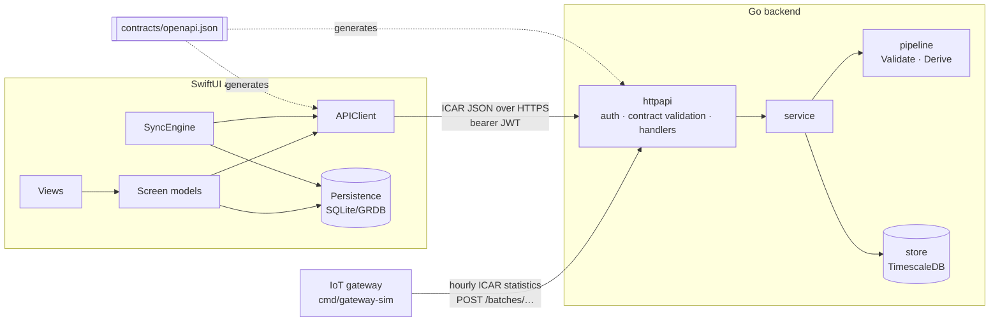

# Architecture

## Contract

`contracts/openapi.json` is the single source of truth. `contractgen` builds it
from two inputs, the vendored ICAR ADE 1.5.1 bundle and the additive
`agritelem.yaml` ([ADR 0002](decisions/0002-contract-first-additive-extension.md)).
oapi-codegen generates the Go types and strict server interface.
swift-openapi-generator generates the Swift client from the same file.

## Backend (`backend/`)

| Package | Responsibility |
|---|---|
| `internal/domain` | ICAR identifiers (ISO 11784 parsing), metric catalogue and bounds, validation of remarks, content hashes. Standard library only. |
| `internal/pipeline` | `Validate` (step 1) and `Derive` (steps 2–5). Pure functions: no I/O, clock injected. See [pipeline.md](pipeline.md). |
| `internal/store` | PostgreSQL + TimescaleDB via pgx and sqlc; migrations are embedded (goose). |
| `internal/service` | Use cases: ingest orchestration, summaries, herd overview, remarks. Depends on a narrow `Store` interface. |
| `internal/httpapi` | Generated strict server plus handlers, middleware (request ID, access log, recover, auth, body limit, contract validation) and ICAR error bodies. |
| `internal/auth` | EdDSA JWT verification, scopes and location grants. |
| `cmd/api` | Server with graceful shutdown. |
| `cmd/seed`, `cmd/gateway-sim`, `cmd/devtoken` | Demo herd, simulated telemetry with a throughput report, dev tokens. |

**Ingest path.** For each resource in a batch:
1. Validate it (step 1).
2. Check the animal belongs to the location.
3. In **one transaction**: claim `(source, sourceId)` in `ingest_keys`, bulk-copy
   the hourly rows of new resources into the hypertable, and quarantine
   rejects.

The response is one ICAR `icarBatchResult` per resource: accepted, replayed,
conflict or rejected, with messages.

**Read path.** SQL takes the latest revision of each hour and rolls the hours
into UTC days. `pipeline.Derive` then adds coverage, imputation, baselines and
flags.

**Security.**
- Every API route needs a bearer JWT (EdDSA, with `iss`, `aud` and `exp`
  checked) holding the operation's scope and a grant for the location.
- Writes must carry `meta.source` equal to the token subject.
- Requests are authenticated before the body is read, bodies are capped at
  5 MiB, and every request is validated against the contract before it
  reaches a handler.
- Logs never include headers or bodies.

## iOS (`ios-client/`)

| Module | Responsibility |
|---|---|
| `AgritelemKit/Domain` | Value types shared by every layer. |
| `AgritelemKit/APIClient` | The generated client behind an `AgritelemAPI` protocol, with typed `APIError` classification. The `allOf` mapping is confined to one file. |
| `AgritelemKit/Persistence` | GRDB store: cached animals, remarks, a FIFO mutation queue, watermarks, cached documents. Observed as async sequences. |
| `AgritelemKit/Sync` | `SyncEngine` actor: FIFO push, pull with a server-derived watermark ([ADR 0005](decisions/0005-offline-sync-protocol.md)). |
| App: `AppModel` | Composition root; triggers sync on launch, on foreground, on reconnect and after local writes. |
| App: screen models | `@MainActor @Observable`; cache-first, then network; derived rows cached as stored properties. |
| App: views | One `View` per section with narrow inputs; Swift Charts content split into `ChartContent` types. |

The project file is generated by XcodeGen from `project.yml`.
`-AgritelemDemo` runs the app on built-in deterministic data; the UI tests
and previews use it, so neither needs a server.
