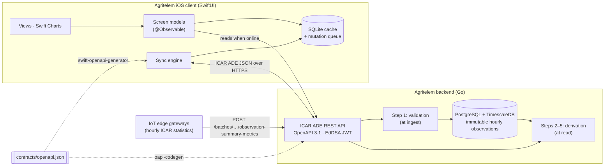
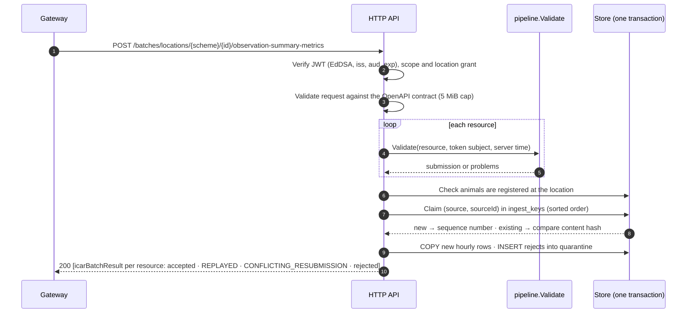
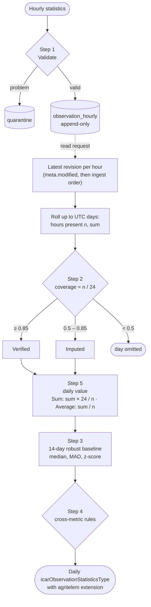
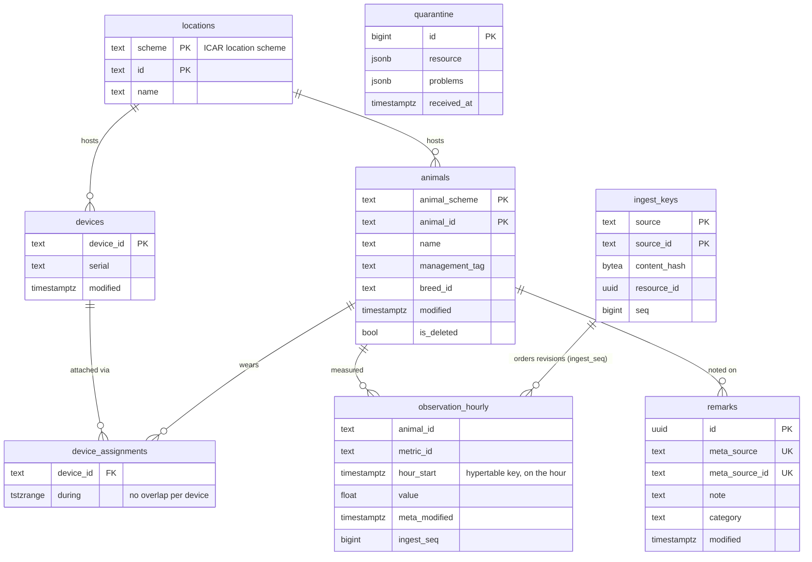
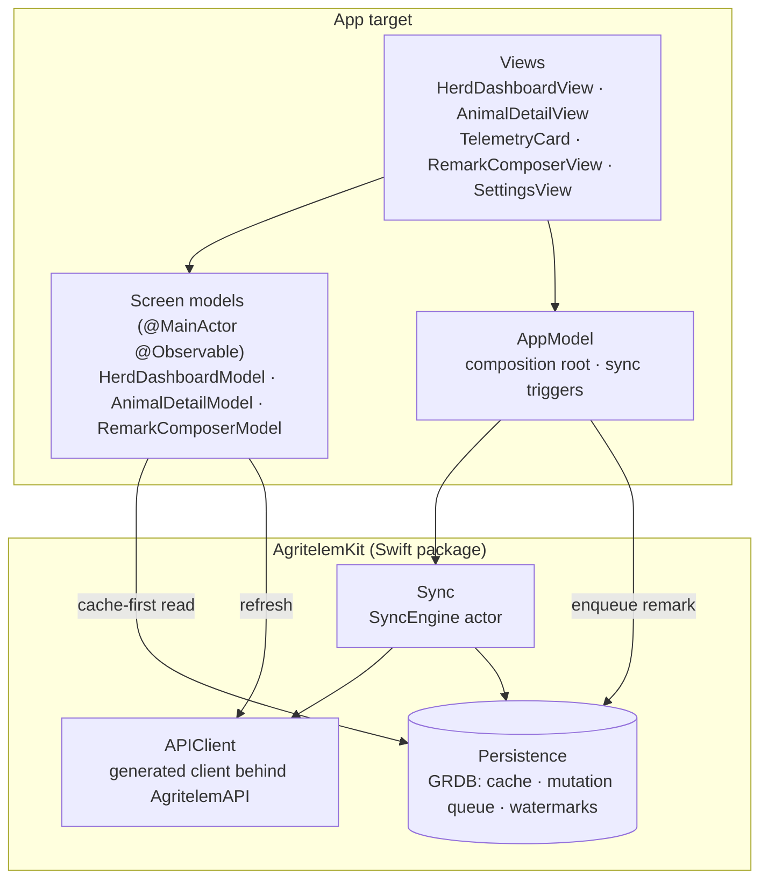
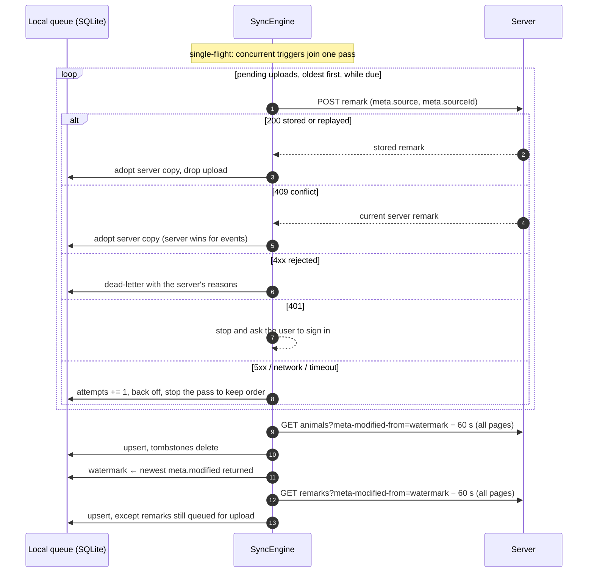
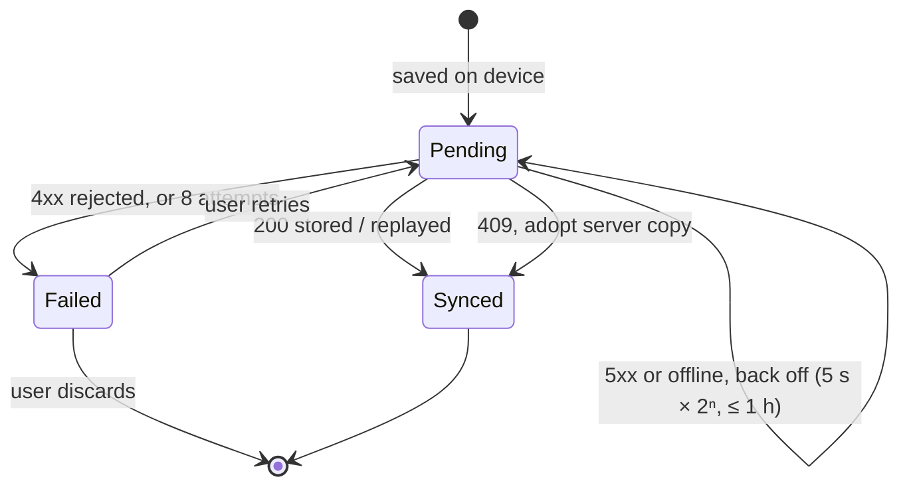

# System Specification: Agritelem — Precision Livestock Telemetry & Herd Management

**Agritelem** is a full-stack precision livestock telemetry and herd management platform. It implements a subset of the **ICAR Animal Data Exchange (ADE) 1.5.1** standard (OpenAPI 3.1, JSON Schema 2020-12) to ingest, validate, store, analyse and visualise sensor telemetry and animal events.

This document specifies the behaviour of the system as implemented. Values marked **[chosen]** are engineering choices, tunable and not domain truth. Planned work that is not yet implemented is listed in §7.

---

## 1. System Architecture Overview

Agritelem couples a Go **backend** with an offline-first **SwiftUI iOS client**:
- The backend ingests hourly telemetry from IoT edge gateways and derives daily statistics.
- The client is engineered for use in the pasture and the parlour, where connectivity is intermittent.

Both are generated from one OpenAPI contract.



---

## 2. Backend Service Specification

### 2.1 Domain Model & ICAR ADE Resources

Agritelem uses ICAR ADE 1.5.1 resources unchanged. Agritelem-specific data travels in additive `agritelem` extension objects, so every ICAR constraint still holds.

| ICAR resource / type | Fields used | Purpose |
|---|---|---|
| `icarMetaDataType` | `source`, `sourceId`, `modified`, `creator`, `isDeleted`, `validFrom`, `validTo` | Provenance and synchronisation. `source` (reverse DNS) names the source system; `sourceId` is unique within it; `isDeleted` marks tombstones. |
| `icarAnimalIdentifierType` | `scheme`, `id` | Animal identity; see §5 for the accepted schemes. |
| `icarAnimalCoreResource` | `identifier`, `name`, `managementTag`, `primaryBreed`, `birthDate`, `specie`, `gender`, `status`, `location`, `meta` | Herd demographics. Breeds use ICAR `icar.breed-3` codes (`HOL`, `JER`, `BSW`, `MON`). |
| `icarDeviceResource` | `id`, `serial`, `name`, `isActive`, `animal`, `meta.validFrom`/`validTo` | Sensor hardware and the animal it is currently attached to. |
| `icarObservationSummaryResource` | `animal`, `meta`, `statistics[]` | A batch of statistics for one animal: hourly on ingest, daily or hourly on read. |
| `icarObservationStatisticsType` | `metric`, `startDateTime`, `duration`, `aggregation`, `unit`, `value`, `isIncomplete`, **`agritelem`** | One statistic. `agritelem` carries derived fields: `coverage`, `dataQuality`, `baselineMedian`, `zScore`, `flags`. |
| `icarRemarkEventResource` | `animal`, `eventDateTime`, `note`, `responsible`, `meta`, **`agritelem.category`** | Field observations. The category is General, Veterinary, Behaviour or Feeding. |
| `icarBatchResult` / `icarResponseMessageResource` | `id`, `meta`, `messages[]` (`type`, `severity`, `status`, `detail`, `instance`) | Per-resource batch outcomes and RFC 7807-style errors. |

#### Metrics

Metrics are ICAR `{scheme, id}` identifiers. `org.icar.activities` codes are used wherever ICAR defines one. Units are UN/CEFACT codes.

| Metric | Scheme | Unit | Hourly aggregation | Hourly bounds | Daily bounds |
|---|---|---|---|---|---|
| `RuminationTime` | `org.icar.activities` | `MIN` | Sum | 0–60 [chosen] | 0–720 |
| `EatingTime` | `org.icar.activities` | `MIN` | Sum | 0–60 [chosen] | 0–720 [chosen] |
| `LyingTime` | `org.icar.activities` | `MIN` | Sum | 0–60 [chosen] | 0–1440 [chosen] |
| `StepCount` | `org.icar.activities` | `ACT` | Sum | 0–5000 [chosen] | 0–60000 [chosen] |
| `ReticularTemperature` | `agritelem.metrics` | `CEL` | Average | 35–43 °C [chosen] | 35–43 °C [chosen] |

### 2.2 Ingestion & the Five-Step Cleaning Pipeline

Gateways submit **hourly** statistics (`duration: PT1H`). The pipeline is split:
- **Step 1 runs at ingest** and decides what is stored.
- **Steps 2–5 run when summaries are read**, over the stored hourly data.

Because steps 2–5 are derived rather than stored, late or out-of-order hours can never leave baselines stale.

#### Ingest



#### Cleaning pipeline



**Step 1: validation at ingest.** A resource is accepted or rejected as a whole, and every problem is reported:

| Rule | Code |
|---|---|
| `meta` present; `meta.sourceId` non-blank (required by Agritelem, optional in ICAR 1.5.1) | `MISSING_FIELD`, `SOURCE_ID_REQUIRED` |
| `meta.source` equals the JWT subject | `SOURCE_MISMATCH` |
| All timestamps UTC | `NON_UTC_TIMESTAMP` |
| `meta.modified`, and each hour's end, no later than server time + 5 min [chosen] | `FUTURE_TIMESTAMP` |
| Animal identifier valid (§5) and registered at the location | `INVALID_ANIMAL_ID`, `UNSUPPORTED_ANIMAL_SCHEME`, `UNKNOWN_ANIMAL` |
| Metric supported; `unit` and `aggregation`, if given, match it | `UNSUPPORTED_METRIC`, `UNIT_MISMATCH`, `AGGREGATION_MISMATCH` |
| `duration` is `PT1H`; `startDateTime` on the hour | `UNSUPPORTED_DURATION`, `MISALIGNED_WINDOW` |
| Value within the metric's hourly bounds | `PHYSIOLOGICAL_OUTLIER` |
| No duplicate metric-and-hour in a resource; at most 744 statistics | `DUPLICATE_STATISTIC`, `TOO_MANY_STATISTICS` |

**Steps 2–5: derivation at read time.**
- **Step 2, completeness:** 85 % coverage makes a day Verified; 50 % [chosen] is the floor for Imputed; below that the day is omitted. ICAR `isIncomplete` is true whenever any hour is missing.
- **Step 5, daily value:** Sum metrics are imputed to a full day at the observed hourly mean; Average metrics use the mean of the hours present.
- **Step 3, baseline:** over the 14 days before the scored day, needing at least 7 of them [chosen], the median and median absolute deviation (MAD) give a robust z-score. The multiplier 1.4826 × MAD estimates the standard deviation, but a single outlier day barely moves it. z is undefined when MAD = 0.
- **Step 4, cross-metric rules:** `HeatSignature` (rumination z ≤ −1.5 and steps z ≥ 2.0), `TimeBudgetConflict` (eating + lying > 1440 min), `ThermalStress` (daily mean reticular temperature ≥ 39.5 °C), and `DailyOutOfRange`. Thresholds are [chosen].

#### Pipeline algorithm (pseudocode)

```text
ALGORITHM Ingest(batch, principal, now):                 -- step 1, at ingest
    FOR EACH resource IN batch:
        problems ← Validate(resource, principal, now)     -- rules in the table above
        IF resource.animal NOT registered AT location: problems += UNKNOWN_ANIMAL
        IF problems: QUARANTINE(resource, problems); REPORT rejected; CONTINUE
        key ← (resource.meta.source, resource.meta.sourceId)
        MATCH CLAIM(key, ContentHash(resource)):          -- hash excludes meta.modified
            NEW(seq):          APPEND hourly rows WITH ingest_seq = seq; REPORT accepted
            EXISTS(same hash): REPORT replayed            -- idempotent retry
            EXISTS(other):     REPORT CONFLICTING_RESUBMISSION
    COMMIT                                                -- all or nothing

ALGORITHM Derive(dailyAggregates, from, to):             -- steps 2–5, at read
    FOR EACH (metric, day, hours n, sum):
        coverage ← n / 24
        IF coverage < 0.5: SKIP
        quality ← coverage ≥ 0.85 ? Verified : Imputed
        value   ← metric IS Sum ? sum × 24 / n : sum / n
    FOR EACH derived day d:
        history ← values of the same metric on d−14 … d−1
        IF |history| ≥ 7:
            median ← MEDIAN(history); mad ← MEDIAN(|history − median|)
            z ← mad > 0 ? (value − median) / (1.4826 × mad) : UNDEFINED
    FOR EACH requested day: APPLY cross-metric rules; EMIT statistics
```

### 2.3 REST API (OpenAPI 3.1, `contracts/openapi.json`)

Every endpoint needs a bearer JWT holding the listed scope and a grant for the path's location. Paths are ICAR's location-scoped scheme.

| Method & path | Scope | Notes |
|---|---|---|
| `GET /locations/{scheme}/{id}/animals` | `animals:read` | `meta-modified-from`, `page-size` (≤ 500), `page-token`. Includes `meta.isDeleted` tombstones. |
| `GET /locations/{scheme}/{id}/devices` | `animals:read` | `meta-modified-from`. An assignment change marks the device modified. |
| `GET /locations/{scheme}/{id}/observation-summary-metrics` | `animals:read` | `animal-scheme`, `animal-id` (required), `duration` `P1D` or `PT1H`, `date-from`/`date-to` (inclusive UTC days, default the last 30, max 366), optional `metric-scheme`/`metric-id`. |
| `POST /batches/locations/{scheme}/{id}/observation-summary-metrics` | `observations:write` | Up to 5,000 resources. Always 200 with an `icarBatchResult` per resource; 413 if too large. |
| `GET /locations/{scheme}/{id}/remarks` | `remarks:read` | `meta-modified-from`, `identifier-scheme`/`identifier-id`, paging. |
| `POST /locations/{scheme}/{id}/remarks` | `remarks:write` | **200** with the stored remark for a new or replayed submission; **409** with `{errors, current}` when the same source ID carries different content; 422 with problems. |
| `GET /agritelem/locations/{scheme}/{id}/herd-overview` | `animals:read` | Agritelem extension: KPIs and per-animal status for the last complete UTC day. |

**Errors.**
- Errors are `icarErrorCollection` (RFC 7807-style messages whose `type` is a stable code).
- Contract violations → 400; semantic rejections → 422; oversized bodies → 413; 401 / 403 / 404 as usual.
- Filters the server does not implement (`meta-modified-to`, and date ranges on remarks) are refused with 400 rather than ignored.

A derived daily statistic, as returned:

```json
{
  "metric": { "scheme": "org.icar.activities", "id": "RuminationTime" },
  "startDateTime": "2026-09-25T00:00:00Z",
  "duration": "P1D",
  "aggregation": "Sum",
  "unit": "MIN",
  "value": 347.29,
  "isIncomplete": false,
  "agritelem": {
    "coverage": 1,
    "dataQuality": "Verified",
    "baselineMedian": 481.47,
    "zScore": -19.34,
    "flags": ["HeatSignature"]
  }
}
```

### 2.4 Persistence



**Invariants**
- `observation_hourly` is append-only. A correction is a new record with a new `sourceId`.
- Readers take, for each hour, the revision with the newest `meta.modified`; a tie goes to the later `ingest_seq`.
- `(source, sourceId)` uniqueness lives in `ingest_keys`, because a hypertable cannot enforce a unique index without its partitioning column.
- Day boundaries are computed as UTC in SQL (`date_trunc('day', hour_start, 'UTC')`) and do not depend on the session time zone.

---

## 3. SwiftUI Client Specification

### 3.1 Architecture

The client is **offline-first**: screen models show cached data immediately and refresh from the network. All writes go through a local mutation queue.



Sync runs:
- when the app starts or returns to the foreground
- when the network becomes available
- after every local write
- on pull-to-refresh

### 3.2 Key Views & Interactions

1. **Herd dashboard**
   - KPI tiles: average rumination (verified days only), estrus alerts, heat stress, veterinary attention, herd size.
   - A carousel of animals needing attention.
   - A searchable herd list with management-tag badges, status symbols and rumination.
   - Filtering by status.
2. **Animal detail**
   - Header: name, tag, breed, age, ISO 11784 identifier, current status.
   - 30-day Swift Charts view, switching between rumination, activity and temperature.
     - Rumination and activity: daily totals as bars; imputed days faded.
     - Temperature: a line over an area, with the heat-stress threshold as a rule.
     - All metrics: the 14-day baseline as a dashed line, findings marked with SF Symbols, drag-to-inspect callouts.
   - The animal's sensors, and its remark timeline with each remark's upload state.
3. **Remark composer (sheet)**
   - Note, category and observation time.
   - Stamps `meta.source` (the signed-in subject), a fresh `meta.sourceId` and `meta.modified`.
   - Saves locally and queues the upload; this works offline.
4. **Settings**
   - Account (token in the Keychain), server, sync status.
   - **Needs Attention**: remarks the server rejected, which can be retried or discarded.

### 3.3 Offline Synchronisation





#### Sync engine (pseudocode)

```text
ALGORITHM Sync():                                    -- single-flight
    FOR EACH mutation IN LocalStore.ReadyMutations(now) ORDER BY creation:
        MATCH API.SubmitRemark(mutation.payload):
            Stored(remark) | Conflict(current):  LocalStore.Complete(mutation, serverCopy)
            Rejected(problems) | Forbidden | NotFound: LocalStore.DeadLetter(mutation, reason)
            Unauthorized:                        RETURN NeedsSignIn            -- no attempt spent
            Transient(error):                    LocalStore.Backoff(mutation); RETURN Deferred
    FOR collection IN [animals, remarks]:
        since ← LocalStore.Watermark(collection) − 60 s                     -- re-read an overlap
        newest ← NONE
        FOR EACH page IN API.List(collection, meta-modified-from: since):
            LocalStore.Apply(page)                                          -- idempotent upserts
            newest ← MAX(newest, MAX(page.meta.modified))                   -- server time only
        IF newest: LocalStore.SetWatermark(collection, newest)              -- after all pages
    RETURN Completed
```

**Guarantees**
- A remark and its upload are written in one transaction.
- Uploads reach the server in creation order.
- Retries are idempotent.
- The device clock never decides what is pulled.
- Switching server discards that server's watermarks and caches, but keeps unsent remarks.

---

## 4. Data Contracts

`contracts/openapi.json` is generated by `backend/cmd/contractgen` from two inputs:
- the vendored ICAR ADE 1.5.1 bundle (`contracts/vendor/icar-ade-1.5.1/`, tag `v1.5.1`)
- the Agritelem extension `contracts/agritelem.yaml`

The extension may only **add**: new paths under `/agritelem/`, new `agritelem*` schemas, and new properties, parameters and responses. The build fails if it changes any ICAR value. Both the Go server and the Swift client are generated from the one file.

An hourly statistic as submitted by a gateway (inside `icarObservationSummaryResource.statistics`):

```json
{
  "metric": { "scheme": "org.icar.activities", "id": "RuminationTime" },
  "startDateTime": "2026-09-25T03:00:00Z",
  "duration": "PT1H",
  "aggregation": "Sum",
  "unit": "MIN",
  "value": 27.5
}
```

A remark as stored and returned:

```json
{
  "resourceType": "icarRemarkEventResource",
  "id": "01a0def8-b355-7508-a00d-57f78f946170",
  "animal": { "scheme": "std.iso.11785", "id": "372000100000003" },
  "location": { "scheme": "dk.herdnumber", "id": "123456" },
  "eventDateTime": "2026-09-26T18:27:15Z",
  "note": "Mounting behaviour observed at milking",
  "agritelem": { "category": "Behaviour" },
  "meta": { "source": "ie.example.gateway", "sourceId": "fixture-remark-1", "modified": "2026-09-26T18:27:15Z" }
}
```

---

## 5. Non-Functional Requirements

- **Provenance.**
  - Every write carries `meta.source` and `meta.sourceId`, and `meta.source` must equal the authenticated subject.
  - Stored observations are immutable; corrections are new revisions.
  - Rejected resources are kept in `quarantine`.
- **Temporal normalisation.**
  - Every API timestamp is UTC with whole seconds (`YYYY-MM-DDTHH:MM:SSZ`). Offsets other than zero are rejected.
  - Daily statistics describe UTC calendar days.
- **Identification.** Animal identifiers use ICAR well-known schemes:
  - `std.iso.11785`: 15 ASCII digits whose first three are an ISO 3166-1 numeric country code, a manufacturer code (900–998) or the test code 999.
  - `eu.animalId`: the same format, but a country code only.
- **Security.**
  - EdDSA-signed JWTs are checked for `iss`, `aud` and `exp` (30 s leeway), and carry scopes and location grants.
  - Tokens are verified before the request body is read.
  - Bodies are capped at 5 MiB, and requests are validated against the contract.
  - Logs never contain headers or bodies.
- **Ingestion scalability.** The target is 10,000 observations/s with batch latency under 200 ms. On one Apple-silicon laptop, with the API and database in local Docker, the gateway simulator measured about 169,000 statistics/s at p99 191 ms (`make sim`, batches of about 6,700 statistics, 4 concurrent). That is a single-machine measurement, not a capacity guarantee.
- **Bandwidth.** Summarising at the edge replaces raw accelerometer streams: 3 axes × 20 Hz × 3,600 s = 216,000 samples per animal-hour become five hourly statistics, a reduction of more than 99.99 %.

---

## 6. Repository Organization

```text
agritelem/
├── backend/                      Go module
│   ├── cmd/
│   │   ├── api/                  HTTP server
│   │   ├── contractgen/          builds contracts/openapi.json
│   │   ├── seed/                 demonstration herd
│   │   ├── gateway-sim/          simulated gateway and load generator
│   │   └── devtoken/             development keys and tokens
│   └── internal/
│       ├── contract/             additive ICAR contract builder
│       ├── domain/               identifiers, metrics, validation (stdlib only)
│       ├── pipeline/             Validate (step 1), Derive (steps 2–5)
│       ├── store/                TimescaleDB: migrations, sqlc queries
│       ├── service/              use cases
│       ├── httpapi/              generated server, handlers, middleware
│       ├── auth/                 JWT verification
│       ├── config/               environment configuration
│       └── testdb/               disposable TimescaleDB for integration tests
├── ios-client/
│   ├── project.yml               XcodeGen spec
│   ├── App/ Views/ ViewModels/   SwiftUI app
│   ├── Tests/ UITests/           view-model and UI tests
│   └── Packages/AgritelemKit/    Domain · APIClient · Persistence · Sync
├── contracts/
│   ├── openapi.json              generated contract (single source of truth)
│   ├── agritelem.yaml            Agritelem extension
│   └── vendor/icar-ade-1.5.1/    ICAR ADE bundle and licence
└── docs/                         architecture, pipeline, ICAR alignment, decision records
```

---

## 7. Planned (not in this release)

- ICAR `icarMilkingVisitEventResource` and `icarReproHeatEventResource` endpoints, and their entry in the event logger.
- Device management over the API (devices are seeded in this release).
- GPS tagging of remarks.
- Parity in the animal header (ICAR lactation resources).
- Hour-of-day-profile imputation, to replace mean imputation, which overestimates sums when the missing hours are the low-activity part of the day.
- Location time zones for "farm days".
- Rate limiting and quarantine retention.
